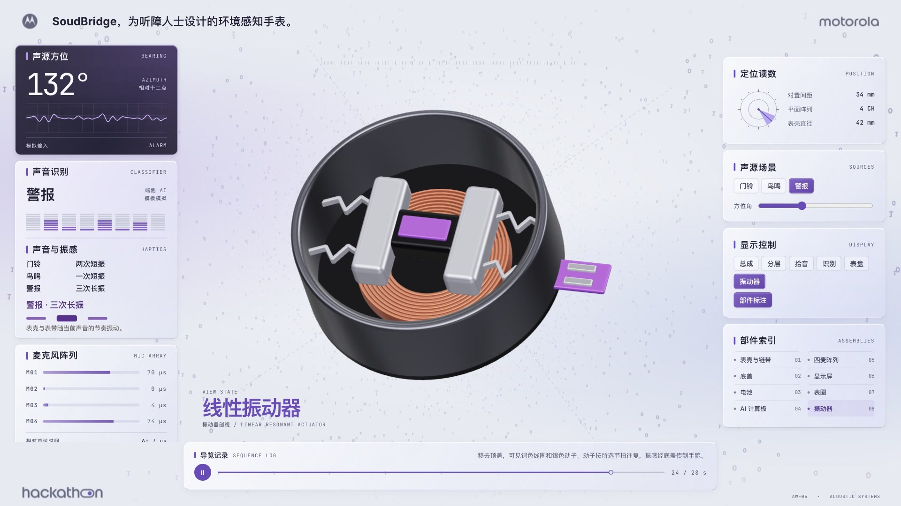

# AW-04 声源定位手表

这款四麦克风概念手表为聋人和听障用户设计，通过腕上振动提示声音类别，通过表盘扇区显示声音方向。旋转手表，展开八组部件，或切换门铃、鸟鸣和警报，观察声源方位如何映射到表盘上的紫色扇区。声音类别和四通道到达时差均使用模拟输入。

在「声音与振感」中，为门铃、鸟鸣和警报分别选择节奏，或选「仅表盘提示」。点「试振」会展示完整手表，表壳与表带随所选节奏一起振动，脉冲间回到原位。选择会自动保存在当前浏览器。交互页会向支持振动的设备发送节奏，侧栏同步标出节拍。表盘显示声音类别和方位。

点「＋ 自定义声音」可以添加「洗衣机完成提示」等声音名称，并选择振动节奏。保存后可在「声源场景」中选用，点击自定义名称可修改或删除。自定义类型用于手动模拟，实际环境声音识别需要相应的音频样本和识别模型。

振动器固定在贴腕底盖内侧，与电池并排。点「振动器」可移去上盖，观察动子随当前节拍往复、在两次脉冲之间停下。剖视放慢了往复运动，便于看清。概念模型的外形尺寸参考 [Precision Microdrives 8 mm 圆片式线性振动器](https://precisionmicrodrives.com/cdn/datasheets/C08-005%20-%20datasheet-004/c08-005-datasheet-004.pdf)，内部结构为示意。

- [下载离线交互页](teardown-out/dist/AW-04.html?raw=true)，用支持 WebGL 2 的浏览器打开。拖动旋转，滚轮缩放，点选右侧部件即可单独查看。
- [观看或下载演示视频](teardown-out/AW-04.mp4)，28 秒，1920 × 1080，60 fps，含同步音效。
- [查看模型、声学模拟和动画源码](AW-04/)。

本地开发使用 Node.js 22.12 或以上版本。运行 `npm ci`、`npm run dev` 可预览搭配浅紫色 Tunnel Wrap 粒子背景的手表工作台。运行 `npm run build` 会生成网站首页，并更新可直接打开的离线 HTML。
