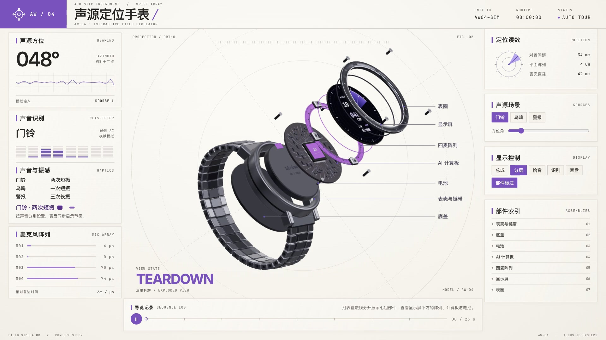

# AW-04 声源定位手表

这款四麦克风概念手表为聋人和听障用户设计，通过腕上振动提示声音类别，通过表盘扇区显示声音方向。旋转手表，展开七组部件，或切换门铃、鸟鸣和警报，观察声源方位如何映射到表盘上的紫色扇区。声音类别和四通道到达时差均使用模拟输入。

在「声音与振感」中，为门铃、鸟鸣和警报分别选择节奏，或选「仅表盘提示」。点「试振」可触发一次对应的模拟声音。选择会自动保存在当前浏览器。交互页会向支持振动的设备发送节奏，同时在表盘和侧栏显示节拍，方便静音使用。

- [下载离线交互页](teardown-out/dist/AW-04.html?raw=true)，用支持 WebGL 2 的浏览器打开。拖动旋转，滚轮缩放，点选右侧部件即可单独查看。
- [观看或下载演示视频](teardown-out/AW-04.mp4)，25 秒，1920 × 1080，60 fps，含同步音效。
- [查看模型、声学模拟和动画源码](AW-04/)。
